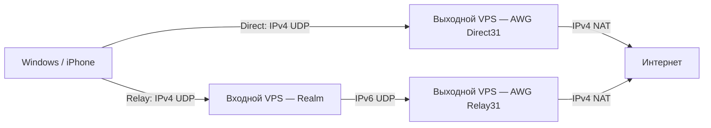

# Amnezia IP v6 — персональный VPN с межсерверным транспортом IPv6

Документация проекта персонального VPN на базе AmneziaWG 3.1 (AWG) и UDP-ретранслятора Realm. Два независимых способа подключения: прямой доступ к выходному серверу и доступ через промежуточный VPS. Межсерверный участок второго маршрута работает по IPv6; клиенту для подключения достаточно IPv4.

**Состояние на 20 ноября 2026 года:** AWG 3.1 развёрнут, серверные проверки Direct и Relay успешно выполнены, работоспособность нового подключения на Windows подтверждена владельцем. Вывод прежней конфигурации AWG 2.0 из эксплуатации ещё не подтверждён.

## 1. Цель и границы проекта

- Создать собственный VPN для персонального использования на Windows и iPhone.
- Использовать два независимых маршрута для сравнения доступности и стабильности.
- Отделить промежуточный сетевой транспорт от VPN-сервера, который завершает шифрованный туннель.
- Сохранить защиту от утечек, изоляцию внутренних сетей и работоспособность уже размещённых на VPS приложений.
- Обеспечить управляемость, воспроизводимость конфигурации и безопасное обновление компонентов без перезагрузки серверов.

Это не публичный VPN-сервис и не универсальный инсталлятор. Репозиторий на данном этапе — документация фактического развёртывания и принятых инженерных решений. Пароли, ключи, клиентские конфигурации и действующие публичные адреса в Git не хранятся.

## 2. Архитектура



| Узел | Роль |
| --- | --- |
| Rialbase (входной VPS) | Принимает UDP от клиента по IPv4; Realm пересылает датаграммы на установленный IPv6-адрес выходного VPS |
| HIP1 (выходной VPS) | Два независимых экземпляра userspace AmneziaWG 3.1; завершение VPN, IPv4 NAT, правила изоляции |
| Windows / iPhone | Клиент AmneziaVPN с отдельным профилем для каждого маршрута |

### Direct31

Клиент устанавливает AWG-туннель непосредственно с выходным VPS по IPv4. Промежуточный сервер не участвует в передаче данных. Этот маршрут также полезен как контрольный вариант при диагностике Relay.

### Relay31

Клиент обращается по IPv4 к входному VPS. Realm передаёт UDP-датаграммы по IPv6 на выходной сервер и возвращает ответ клиенту. Realm не завершает AWG-сессию и не расшифровывает VPN-трафик. Его назначение — транспортный ретранслятор с фиксированным назначением, а не произвольный прокси.

Оба маршрута имеют один и тот же внешний IPv4 выхода, но отдельные экземпляры AWG, интерфейсы, адресные пространства и пары ключей. Отказ Realm не должен нарушать Direct; отказ самого HIP1 затрагивает оба маршрута. Автоматическое переключение между ними не реализовано.

### Что означает IPv6 в названии

IPv6 используется именно на участке между VPS. Внутри VPN передаётся IPv4-пользовательский трафик; выход клиентского IPv6 пока не реализован. Клиентский IPv6 захватывается полным туннелем и блокируется, чтобы не допустить обход VPN через локальное подключение. Это осознанное ограничение, а не полноценный IPv6 VPN.

## 3. Компоненты и версии

| Компонент | Версия / реализация |
| --- | --- |
| AmneziaWG userspace | [v3.1.20261116](https://github.com/amnezia-vpn/amneziawg-go/tree/v3.1.20261116) |
| Upstream commit AWG | `08fe3d33bbb116be09a6183d02609311b8b0c9e8` |
| Realm | [v2.9.6](https://github.com/zhboner/realm/releases/tag/v2.9.6) |
| Клиентский формат | Сверен с импортёром [AmneziaVPN 5.1.1.10](https://github.com/amnezia-vpn/amnezia-client/releases/tag/5.1.1.10) |
| Управление службами | systemd |
| Сетевая фильтрация | Выделенные цепочки iptables |
| DNS | Cloudflare |
| MTU туннелей | 1280 |

Версии и commit приведены по отчёту исполнителя о развёртывании от 20.11.2026. Функциональность AWG 3.1 проверена через UAPI; строка версии в баннере upstream историческая и сама по себе недостаточна для идентификации сборки. Криптографическое ядро не изменялось. Для полного воспроизведения сборок следует сверяться с локальным manifest и upstream. Контрольные суммы установленных бинарников зафиксированы в серверном отчёте.

## 4. Службы и интерфейсы

| Узел | systemd | Интерфейс |
| --- | --- | --- |
| HIP1 | `personal-awg31-direct.service` | `awg31d` |
| HIP1 | `personal-awg31-relay.service` | `awg31r` |
| Rialbase | `personal-realm31.service` | UDP-ретранслятор |
| Rialbase | `personal-realm31-firewall.service` | Собственные правила входного VPS |

Службы AWG и Realm настроены на автоматический запуск. Состояние автозапуска следует периодически проверять; фактическое прохождение полного reboot-теста в отчёте не подтверждено.

Каждый экземпляр имеет собственные серверные ключи, параметры протокола, подсеть, интерфейс и UDP endpoint. Realm использует фиксированный backend. Реальные адреса, порты и параметры конкретного развёртывания в README намеренно не включены.

## 5. Клиенты

| Профиль | Устройство | Маршрут |
| --- | --- | --- |
| Windows-Direct31.conf | Windows | Direct |
| Windows-Relay31.conf | Windows | Relay |
| iPhone-Direct31.conf | iPhone | Direct |
| iPhone-Relay31.conf | iPhone | Relay |

Каждая конфигурация имеет отдельную пару клиентских ключей и собственный адрес внутри туннеля. Профили импортируются как новые подключения в совместимый клиент AmneziaVPN. Клиентские файлы хранятся только на доверенных устройствах и в закрытом серверном каталоге. Не следует публиковать их в GitHub, отправлять в публичные чаты либо помещать в скриншоты.

При проверке следует учитывать настройку раздельного туннелирования: включённое исключение для браузера может привести к тому, что внешний IP браузера будет отличаться от IP VPN. Для проверки полного туннеля необходимо исключить влияние других VPN и прокси.

## 6. Безопасность и изоляция

- Раздельные ключи для каждого клиента и серверного экземпляра.
- Закрытые каталоги конфигурации (0700) и файлы с ключами (0600).
- Отдельные правила фильтрации и NAT, без изменения глобальной политики firewall.
- Ограничение доступа к служебным портам, локальным и частным сетям.
- На выходном сервере вход Relay по IPv6 ограничен входным VPS; неиспользуемые семейства адресов для соответствующих endpoint закрыты.
- DNS Cloudflare через VPN; отсутствие внешнего клиентского IPv6 при текущей модели IPv4-выхода.
- Исключение для публичного HTTPS выходного VPS при сохранении существующей авторизации веб-приложений.
- Отдельный мониторинг функционирования VPN и инфраструктурных служб.

VPN не обеспечивает анонимность сам по себе, не исключает корреляцию соединений, не гарантирует доступность при любых сетевых ограничениях. DNS-провайдер и выходной сервер остаются доверенными сторонами. Клиентский kill switch и предотвращение утечек при внезапном разрыве соединения требуют отдельного тестирования.

## 7. Известный инцидент: публичный HTTPS выходного VPS

При первоначальном подключении через Relay 2.0 браузер не мог открыть веб-интерфейс, размещённый на самом выходном сервере. После отключения туннеля доступ восстанавливался.

Независимая диагностика из третьей сети показала, что SSH, nginx, Docker и Codex Bridge работали. Последующая проверка новых туннелей подтвердила: запрос к собственному публичному IPv4 HIP1 попадал в локальную цепочку INPUT, а не FORWARD, и блокировался правилами изоляции.

Исправление в AWG 3.1: ограниченное исключение для TCP 443 публичного IPv4 HIP1 на обоих VPN-интерфейсах. SSH и другие служебные порты сохранены закрытыми. Правка сохранена в постоянном firewall-скрипте и применена без перезапуска VPN. Исключение относится ко всем публичным HTTPS-виртуальным хостам на этом адресе, не только к одному домену; действующая авторизация приложений не менялась. HTTP на TCP 80 из VPN остался закрытым.

Также выявлен отдельный недостаток веб-инфраструктуры: отсутствие AAAA для домена и TLS listener nginx по IPv6. Для текущего VPN с IPv4-выходом это исправление не требуется; полноценный IPv6-доступ к веб-сервисам — отдельная задача.

## 8. Испытания и подтверждённые результаты

| Проверка | AWG 3.1 Direct | AWG 3.1 Relay |
| --- | --- | --- |
| Handshake | Успешно | Успешно |
| DNS через туннель | Успешно | Успешно |
| Внешний HTTPS | HTTP 200 | HTTP 200 |
| Внешний IPv4 | HIP1 | HIP1 |
| Блокировка клиентского IPv6 | Подтверждена | Подтверждена |
| Блокировка частных сетей и SSH | Подтверждена | Подтверждена |
| Публичный HTTPS HIP1 после исправления | HTTP 200, TLS валиден | HTTP 200, TLS валиден |
| IPv6 между VPS | Не применяется | Подтверждён захватом заголовков пакетов |

Серверные испытания выполнялись временными изолированными peer без изменения основной маршрутизации тестового VPS; тестовые ключи и процессы после проверки были удалены. В Relay-тесте первоначальный клиент находился на самом входном VPS, поэтому этот тест сам по себе не подтверждает доступность клиентского участка из внешней сети. Позднее пользователь подтвердил работоспособность нового подключения на Windows.

Отдельно для прежней версии AWG 2.0 на Windows был выполнен тест ipleak.net: внешний IPv4 соответствовал HIP1, DNS — Cloudflare, дополнительных публичных адресов IPv6 и WebRTC не обнаружено. Не следует автоматически переносить эти результаты на все устройства и все профили 3.1.

Не завершены или не документированы: полноценные отдельные тесты утечек обоих профилей 3.1, iPhone через Wi-Fi и мобильную сеть, аварийный разрыв туннеля, длительная стабильность, производительность под нагрузкой и перезагрузка обоих VPS. Результаты в таблице основаны на отчётах Codex; независимый аудит фактических серверных файлов в рамках подготовки README не выполнялся.

## 9. История развёртывания

| Этап (20.11.2026) | Результат |
| --- | --- |
| Диагностика межсерверного канала | Обнаружен отсутствующий обратный IPv6-маршрут на HIP1 |
| Постоянная IPv6-маршрутизация | Настроен default route через предоставленный провайдером шлюз; проверены SSH и HTTPS по IPv6 |
| Первоначальный AWG 2.0 + Realm | Развёрнуты и проверены Direct/Relay, включая реальный Windows-клиент |
| Миграция на AWG 3.1 | Подняты два независимых экземпляра и отдельный Realm; 2.0 временно сохранён |
| Диагностика HTTPS | Выявлена блокировка локального адреса правилами VPN |
| Исправление HTTPS | Правка для 3.1, серверные тесты успешны, пользователь подтвердил работу |
| Вывод AWG 2.0 | Запланирован после подтверждения 3.1; фактическое удаление не подтверждено |

Для сопровождения используются отчёты задач Codex Bridge. При наличии доступа к внутреннему репозиторию история работ доступна по идентификаторам:
`20261120-hip1-ipv6-persist-no-load`,
`20261120-hip1-rialbase-awg2-realm-deploy`,
`20261120-hip1-rialbase-awg31-migration`,
`20261120-hip1-awg31-public-https-fix`.
Отчёты агента следует сверять с фактическими состояниями хостов.

## 10. Эксплуатация

Порядок диагностики: сначала проверить работоспособность обеих сторон отдельно, затем проверить полный маршрут.

- На клиенте: проверить внешний IPv4, DNS, доступность обычного HTTPS и публичного HTTPS HIP1.
- На входном VPS: проверить состояние Realm и IPv6-маршрутизацию до выходного VPS.
- На выходном VPS: проверить состояние двух AWG-интерфейсов, служб и счётчиков их собственных firewall-цепочек.
- При отказе только Relay: проверить входной VPS и межсерверный участок; при отказе обоих маршрутов — начать с HIP1.
- Если доступ к обычным сайтам есть, а собственный веб-интерфейс недоступен — проверить локальную маршрутизацию и INPUT-фильтрацию.
- Перед обновлением: убедиться в наличии независимого административного доступа, проверить версии и зависимости, подготовить точечный откат; после изменения повторить положительные и отрицательные сетевые проверки.

Пример безопасных команд просмотра состояния на соответствующем хосте:

```sh
# HIP1
systemctl is-active personal-awg31-direct.service personal-awg31-relay.service
systemctl is-enabled personal-awg31-direct.service personal-awg31-relay.service
ip -brief link show awg31d
ip -brief link show awg31r
ip -6 route show default

# Rialbase
systemctl is-active personal-realm31.service
systemctl is-enabled personal-realm31.service
ip -6 route show default
```

Полные журналы, вывод конфигураций и сетевые дампы перед публикацией необходимо проверять на наличие чувствительной информации. Не изменять посторонние приложения, Docker, nginx, SSH и маршрутизацию без отдельного плана изменений.

## 11. Материалы и следующие задачи

README — начальная точка документации. В дальнейшем целесообразно добавлять обезличенные схемы конфигурации, инструкции по восстановлению, журнал изменений, матрицу совместимости и результаты тестов Windows/iPhone. Фактические ключи, адреса и параметры остаются в закрытом контуре.

Ближайшие задачи:

- [ ] Подтвердить завершение вывода AWG 2.0 и его выделенного ретранслятора из эксплуатации.
- [x] Проверить публичный HTTPS выходного узла из AWG 3.1.
- [ ] Зафиксировать отдельные результаты тестов Direct31 и Relay31 на Windows и iPhone.
- [ ] Проверить поведение при разрыве туннеля, переподключении и смене сети.
- [ ] Измерить длительную стабильность, задержку и пропускную способность.
- [ ] Описать восстановление после отказа VPS без публикации действующих ключей.

## 12. Внешние проекты

- [AmneziaWG Go](https://github.com/amnezia-vpn/amneziawg-go) — реализация протокола.
- [AmneziaVPN client](https://github.com/amnezia-vpn/amnezia-client) — клиентские приложения.
- [Realm](https://github.com/zhboner/realm) — сетевой ретранслятор.
- [IPLeak](https://ipleak.net/) — проверка адресов и DNS.

Данный репозиторий не является официальным проектом Amnezia или Realm.
